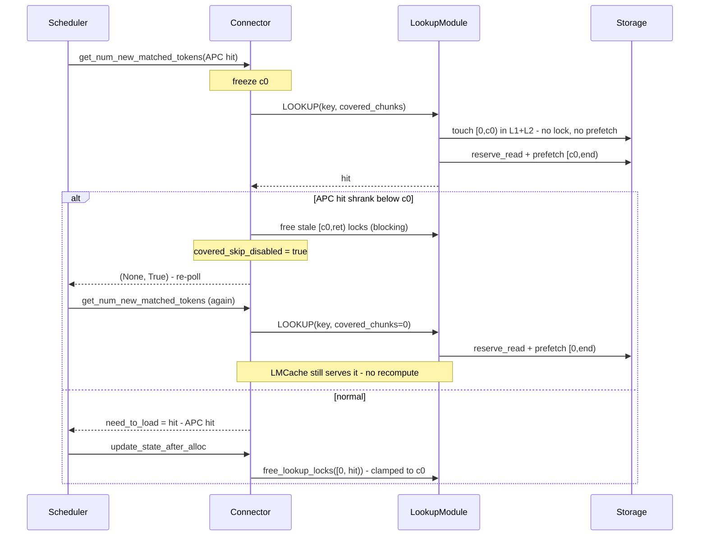

# APC-covered lookup skip (non-pin method)

vLLM's prefix cache (APC) often already holds the first `N` tokens of a
request. LMCache looked them up anyway — read-locking them and pulling them
from L2 into L1 — even though vLLM will never read them.

```
[========= APC already has this =========][==== LMCache loads ====]
0                                         c0                     end
 \__ locked + prefetched for nothing __/
```

Two gates, both default off: the server's `--skip-apc-lookup` decides whether
to honor a covered count, and the engine's `lmcache.mp.skip_covered_lookup`
decides whether to send one. The skip happens only when both are set, and any
other combination behaves exactly as before.

**The server owns the behavior** -- not locking and not prefetching are its
work -- so it must be able to refuse. The two sides can disagree safely
because the server clamps every release to the prefix *it* actually skipped,
so the engine can always send the release RPC and let the server decide what
it covers. An engine-side elision of that RPC, keyed on what the engine
believed was skipped, is what would make disagreement unsafe; there is none.

## What changes

`LookupModule.lookup` reads `covered_chunks` from the key's `request_configs`
(carried there to avoid a proto change). For the covered prefix `[0, c0)` it:

- **touches** it in **L1 and L2** — no bytes move, nothing is promoted. Both
  tiers matter: a real load refreshes recency in both, so touching only L1
  would leave the keys cold to L2 and get them evicted.
- **does not** lock or prefetch it. The prefetch covers `chunk_hashes[c0:]`
  only; hit counts shift back to absolute at status time.

So the prefix is no longer *promoted* into L1 on every lookup — that
promotion was the waste. Cache contents are unchanged; only placement is.

## The shrink race

A WAITING request's APC blocks are unprotected until `allocate_slots`, so the
APC hit can shrink while the lookup is in flight, leaving the frozen `c0`
covering a gap nobody owns.

**This branch does not pin.** It re-looks-up instead — the request is *not*
handed back to vLLM to recompute. Free the stale `[c0, ret)` locks, set the
sticky `covered_skip_disabled` (so the request never skips again — one shrink
each, no churn, survives preemption), reset per-lookup state, and return
`(None, True)`. The scheduler re-polls, this time submitting
`covered_chunks = 0`, and LMCache serves the whole prefix `[0, ret')` from
token 0. The request keeps its cache hit; it only stops skipping.

That free **blocks** until every server acks. `LOOKUP` and
`FREE_LOOKUP_LOCKS` share the normal thread pool, so with
`max_cpu_workers > 1` a fire-and-forget release could land *after* the
replacement lookup's `begin_lookup` reset the session — over-releasing the
prefix and leaking the stale locks.

Pinning the covered blocks instead is implemented in `core/skip-apc-pin` and
weighed in `apc_covered_lookup_comparison.md`. Non-pin won: no block-pool
pressure, no coupling to vLLM's `BlockPool`, and a shrink costs one wasted
lookup rather than held GPU blocks.

## The invariant

Read locks are anonymous refcounts **shared across prefix-sharing requests**,
so releasing one you never took corrupts another request. Every release goes
through `resolve_prefetched_obj_keys`, whose per-group range start is clamped
to `c0` — it cannot reach into the skipped prefix.

## Flow


